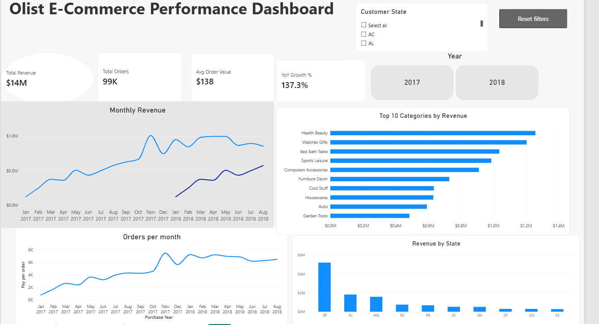
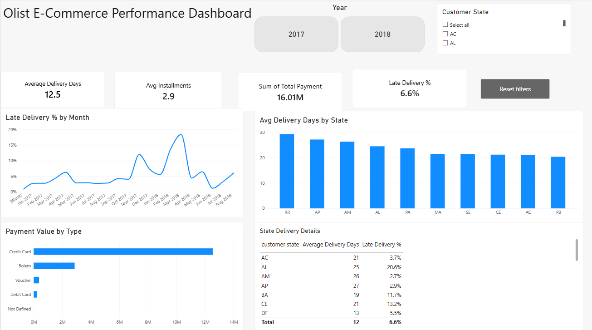

# Olist E-Commerce Performance Dashboard

An interactive, two-page Power BI dashboard analyzing approximately 99,000 orders from the Olist Brazilian E-Commerce marketplace (January 2017 – August 2018). The project explores sales trends, delivery performance, geographic revenue distribution, and customer payment behavior.

**Tools:** Power BI · Power Query · DAX · Star Schema Modeling

## Dashboard Preview

### Page 1: Sales Overview

Analyzes revenue trends, order volume, average order value, top product categories, and revenue by state.

### Page 2: Delivery & Payments

Explores delivery times, late-delivery rates, payment methods, and installment behavior.

## Business Questions Answered

- How has revenue changed over time, and which product categories and Brazilian states generate the most revenue?
- How does order delivery performance vary over time and across states?
- When do late deliveries spike, and how does the late-delivery rate compare with the overall average?
- Which payment methods do customers prefer, and how many installments do they use on average?
- What are the overall order volume, average order value, and delivery-time trends?

## Key Business Insights

- **Geographic performance:** São Paulo leads revenue, followed by Rio de Janeiro and Minas Gerais.
- **Revenue growth:** Monthly revenue peaked in November 2017 at approximately R$1.0 million. Revenue from January–August 2018 was approximately 137% higher than the same period in 2017.
- **Top categories:** Health & Beauty, Watches & Gifts, and Bed Bath & Table rank among the leading product categories by revenue.
- **Delivery performance:** The overall late-delivery rate is approximately 6.6%, reaching around 18% in March 2018. Average delivery time is approximately 12.5 days.
- **Payment behavior:** Credit cards dominate payments, with customers using approximately 2.9 installments on average.

## Technical Implementation

- **Data preparation:** Cleaned data types, handled missing values, standardized text, and merged product category translations using Power Query.
- **Data modeling:** Built a star schema with a dedicated date table and one-to-many relationships.
- **DAX measures:** Created calculations for revenue, unique orders, average order value, year-over-year growth, delivery time, late-delivery rate, and payment value.
- **Interactivity:** Implemented synchronized slicers, KPI cards, interactive visuals, and a reset-filters button using bookmarks.

## Dataset & Files

**Dataset:** [Olist Brazilian E-Commerce Public Dataset — Kaggle](https://www.kaggle.com/datasets/olistbr/brazilian-ecommerce)

The raw dataset is not included in this repository. Download it from Kaggle to reproduce the analysis, subject to the dataset's license terms.

- `olist-sales-dashboard.pbix` — Interactive Power BI report.
- 'olist-sales-dashboard.pdf' — PDF export of both dashboard pages.

## Notes

- Year-over-year growth compares January–August 2018 with January–August 2017.
- An order is classified as late when its actual delivery date is later than its estimated delivery date.
- Revenue currency and metrics should be verified against the report's underlying measures.

## Author

**Ayan Basit**
